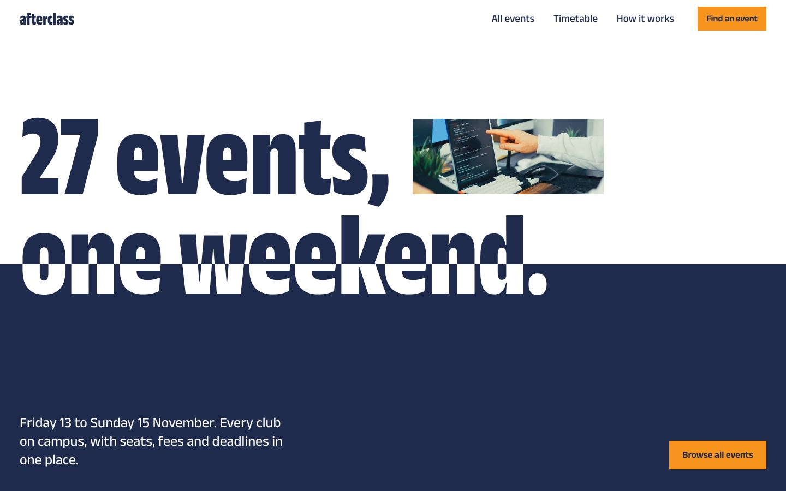

# afterclass

**Every club event on campus, in one place.** A landing page and events pages for the Render72 Events API, built for the Render72 frontend and design hackathon run by CORE Lab.

- **Live site:** https://render72.vercel.app



## What's here

| Page | What it does |
| --- | --- |
| `/` | The weekend at a glance: the live seat count, a "what do you feel like doing" finder, the organisers' picks, the full weekend by day, and how registration works. |
| `/events/` | Every event, in a list grouped by day or in a **timetable** that puts each day's events side by side so clashes are obvious. Search, filters, sort and the view all live in the URL, so a filtered view can be shared or bookmarked. |
| `/events/<event-name>/` | One page per event, with schedule, prizes, eligibility, rules, FAQs and contacts. Includes a Register button, an "Add to calendar" file and a share button. |
| `/events/<api-id>/` | Links that use an API id redirect to the event's page. If the id is newer than the build, the page asks the API for it and shows the essentials. |
| `404` | A plain "nothing here" page that points back to the events. |

## Design

The data describes one campus fest weekend: 27 events across Friday 13 to Sunday 15 November, run by 30 clubs, with seats that are running out. The design treats it like a fest poster that is also a timetable.

- **The headline is the hero.** "27 events, one weekend." is set at poster size across a hard split between a white field and a navy field. The letters change colour where they cross the split. A photo slot set into the sentence cycles through the weekend's events. The count comes from the API.
- **Type:** [Anek Latin](https://github.com/EkType/Anek) by Ek Type, Mumbai. It's one variable font used at two widths: condensed for display, regular for reading. It's subset and trimmed to a single 51 KB file.
- **Colour:** navy ink on white, a cool grey for secondary surfaces, and tangerine reserved for actions and for "few seats left". Status is always shown in words, never by colour alone.
- **Shapes:** square corners everywhere, and no drop shadows except on things that genuinely float (the sticky filter bar, the phone action bar, the menu).
- **Data-heavy screens:** the events list reads like a timetable. Each row has the same columns (photo, when, what, entry fee and team size, seats left with a meter, register-by date), so events can be compared by scanning down. On phones each row restacks into a compact card.

## Easter eggs

Two, both built from the page's own design rather than bolted on:

- **The photo in the headline is a slot machine.** Click it (or Tab to it and press Enter). It spins through the weekend's events, slows down and deals you one that still has seats, and the hero offers you that event, with its live seat count. Spin again, or go back.
- **The site answers to its name.** Type `afterclass` anywhere, or click the giant wordmark in the footer. A school bell rings (synthesised with Web Audio, no sound file) and the hero's navy field rises over the screen: *Class dismissed.*

Both respect `prefers-reduced-motion`, and the bell's code is only downloaded when it's triggered. There's also a note in the browser console.

## Motion

The motion is built from the same pieces as the design (the navy field, the split headline, the photos) and costs nothing on load: it is CSS, plus about 2 KB of script that starts after the first paint.

- **Page transitions.** Moving between pages cross-fades, and an event's photo grows from the list, the picks or the related events into the event page's banner. These are CSS view transitions, with no JavaScript; browsers without them simply load the page.
- **The hero.** The navy field rises on load and the white half of the headline appears with it. With a mouse, the two lines sit at different depths and shift against each other, and the photo moves inside its frame like a window. As you scroll away, the lines slide apart. The slot machine's photos flip in like a split-flap departure board.
- **Seats running out.** A ticker under the live seat count scrolls the events with the fewest seats left, with live numbers. It stops while you point at it or tab into it, and has a Pause button.
- **Pointer effects.** Event photos tilt towards the pointer in 3D and zoom inside their frames, buttons lean towards the pointer and sweep to a second colour, and timetable blocks lift with a tangerine rule. In the finder, pointing at an event shows its photo; those photos load only when needed.
- **Scroll effects.** Seat meters fill as they appear, photos in the picks band drift, day and section headings rise in, and the footer wordmark's letters rise out of the bottom of the page one by one (and wave when you point at them). These are scroll-driven CSS animations, so they run off the main thread.

Everything that moves is animated with `transform` and `opacity` only, so nothing causes layout shift or main-thread layout work. Pointer effects are attached only for a mouse or trackpad. With `prefers-reduced-motion`, all of it is off: the ticker becomes a list you can scroll sideways.

## Built to survive API downtime

The site never depends on the API being up at the moment someone visits.

1. **At build time**, every event and its full details are fetched from the API, with timeouts and retries. If the API is down, the build uses `src/data/snapshot.json` (refresh it with `npm run snapshot`). If one event's detail call fails, only that event falls back. Every field is validated and normalised, so a malformed record can't break a page.
2. **In the browser**, each page is already complete HTML. A small script asks the API for current seat counts and registration status, then updates the numbers in place. It uses `GET /api/test/events` everywhere, and event pages also call `GET /api/test/events/{id}`.
3. **When that fails**, the page shows what happened in plain words ("Can't reach the events service. Showing seat counts from 13 Oct, 11:52 pm.") with a **Try again** button. Seat counts saved on the device from an earlier visit are reused when they are newer than the build.
4. **When an event disappears** (the API returns 404 or drops it from the list), its page says it is no longer listed and disables Register. List rows mark it "No longer listed".
5. **Images** are downloaded and optimised during the build. If an image URL is dead, the build continues and the page shows a labelled placeholder.

| Situation | What a visitor sees |
| --- | --- |
| API healthy | Live seat counts, "updated just now" |
| API down or slow (8 s timeout, one retry) | Full pages with the last known numbers, a clear note and a retry button |
| API down at build time | The site builds from the committed snapshot |
| Event removed | "This event is no longer listed", Register disabled |
| Deadline passes while the page is open | Status switches to "Registration closed" within 30 seconds |
| Unknown address | 404 page with a way back |

## Performance and scores

Measured with Lighthouse 13.5 (mobile and desktop presets), against the production build served locally with Brotli compression and against the live site on Vercel:

| Page | Performance | Accessibility | Best practices | SEO |
| --- | --- | --- | --- | --- |
| `/` | 99–100 | 100 | 100 | 100 |
| `/events/` | 99–100 | 100 | 100 | 100 |
| `/events/civicforge-24-build-for-the-city/` | 99–100 | 100 | 100 | 100 |

On the live site (render72.vercel.app), repeated mobile runs scored 98–100 for Performance (LCP 1.3–1.7 s, CLS 0) and 100 for Accessibility, Best practices and SEO on the home, events and event pages; desktop runs scored 100 across the board. These were run from a development machine; [PageSpeed Insights](https://pagespeed.web.dev) runs the same test from Google's servers, so check there after each deploy.

How it gets there:

- **Static HTML first.** Astro renders every page at build time. There's no UI framework in the browser; the page scripts are a few kilobytes of plain TypeScript.
- **CSS inlined** into each page, so nothing blocks the first paint.
- **Off-screen content skips layout** (`content-visibility: auto` on event rows and lower sections). On a 4x slowed CPU this cuts main-thread work on the events page from about 1,045 ms to 643 ms.
- **Live data waits for the first paint.** Seat-count requests start only after the page has rendered, and updates touch only the numbers that changed.
- **One preloaded font file** (51 KB, `font-display: swap`) with size-adjusted fallbacks to limit layout shift.
- **Images served from our own domain** as AVIF and WebP at the right widths, with `srcset`/`sizes`, explicit dimensions, lazy loading below the fold, and a preloaded hero image on event pages. The source photos are on Pexels, whose CDN sets third-party cookies (a Best Practices penalty) and serves much larger files.
- **The hero's cycling photos** load only after the page has finished loading, pause off-screen, and stop for `prefers-reduced-motion`.

## Handling 5–10k visitors a day

The site is static files on a CDN, so visitor count barely affects it. The browser asks the API once per page view, plus once more on an event page. It refreshes again only when a tab comes back into view after a minute; it never polls. Hashed assets and the font are cached for a year (`public/_headers`, `vercel.json`).

## Accessibility

Semantic landmarks and headings, a skip link, real buttons, radios and checkboxes behind every control, and visible focus styles. Result counts and live status are announced politely to screen readers. The timetable scroll area is keyboard focusable, and the FAQs use `<details>`. Text meets WCAG AA contrast. Motion respects `prefers-reduced-motion`, the moving ticker can be paused (and stops on hover or focus), and every page works without JavaScript; only the filters need it.

## SEO

Unique titles and descriptions per page, `schema.org` Event, ItemList and WebSite data, Open Graph tags, `robots.txt`, `sitemap.xml`, readable URLs (`/events/civicforge-24-build-for-the-city/`) and a `noindex` 404.

## Run it

Requires Node 22.12 or newer.

```bash
npm install
npm run dev        # http://localhost:4321
npm run build      # static site in dist/
npm run preview    # serve the build
npm run snapshot   # refresh the offline fallback data from the API
```

Optional environment variables:

| Variable | Purpose |
| --- | --- |
| `SITE_URL` | The public URL, e.g. `https://afterclass.pages.dev`. Enables canonical links, absolute social images and a full sitemap. |
| `PUBLIC_EVENTS_API` | Base URL of the Events API (default `https://render72.pages.dev`). |
| `EVENTS_OFFLINE=1` | Build from the snapshot without calling the API (useful to test the fallback). |

## Deploy

**Cloudflare Pages:** connect the repo, choose the Astro preset (build command `npm run build`, output `dist`), and add the environment variables `NODE_VERSION=22` and `SITE_URL=<your pages.dev URL>`.

**Vercel** (used for the live site): import the repo and deploy. Astro is detected automatically, and the production address is picked up without setting `SITE_URL`.

**Netlify:** build command `npm run build`, publish directory `dist`, `NODE_VERSION=22`.

The first build takes about five minutes because it optimises every photo; later builds reuse the cache where the host keeps it. To pick up new events between deploys, trigger a rebuild with your host's deploy hook. Seat counts are always live regardless.

## Project structure

```
src/
  lib/          api.ts (build-time fetch + fallback), events.ts (view models),
                format.ts (IST dates, ₹, team sizes), availability.ts, images.ts, calendar.ts
  scripts/      live.ts (live seats, cache, retry), events-page.ts (search/filter/sort/URL),
                event-page.ts, slot.ts (hero photos, slot machine), chrome.ts (header colour,
                reveals, easter eggs), bell.ts ("Class dismissed"), motion.ts (tilt, magnetic
                buttons, hero depth, ticker, finder previews)
  components/   Header, Footer, EventRow, Timetable, Pic
  pages/        index, events/index, events/[slug]/index + calendar.ics, 404, robots.txt, sitemap.xml
  data/         snapshot.json (offline fallback)
public/         font (+ licence), icons, _headers
```

## Credits

- Event data and photographs: the Render72 Events API by CORE Lab. Photographs are from Pexels.
- Typeface: Anek Latin by Ek Type, SIL Open Font License 1.1 (`public/fonts/OFL.txt`).
- "afterclass" is a placeholder name for the platform and can be changed in `Header.astro`, `Footer.astro` and the page titles.
- Built by Pawan for Render72, October 2026.
